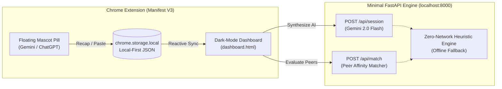

# 🦉 Ambient Study Commons

> **Autonomous Study Journal & Peer Commons for Community College STEM Students**  
> *Built with a Local-First, Zero-Surveillance Architecture.*

---

## 🌟 Overview

When students study with AI assistants like ChatGPT or Gemini, their learning often remains siloed and invisible. **Ambient Study Commons** is a privacy-first companion that sits silently alongside your study sessions. 

Without transmitting your full conversation history to external surveillance databases, it:
1. **Captures Daily Study Recaps**: Synthesizes a daily Master Journal celebrating technical breakthroughs.
2. **Maintains a Skills & Passions Ledger**: Automatically extracts demonstrated competencies (e.g., `x86-64 Assembly`, `gdb Disassembly`) and recurring dream project goals.
3. **Facilitates Actionable In-Person Peer Matches**: Connects classmates stuck on the same assignment (e.g., *CISP 310 Lab 4*) to meet at physical campus study hubs (e.g., *CRC MESA Center*).
4. **Guarantees Local Data Sovereignty**: Operates 100% locally in `chrome.storage.local` with one-click plain-text export and instant data purge.

---

## 🚀 Hackathon Vertical Slice Architecture

For hackathon demonstration and recording, we built a rock-solid, zero-failure vertical slice:



### Core Components
1. **Lightweight Chrome Extension (Manifest V3)**:
   - Floating mascot pill on `chatgpt.com` and `gemini.google.com`.
   - **Auto Recap**: One-click recap injection.
   - **Manual Paste Modal**: Fail-safe paste box with sample Lab 4 study data pre-loaded for instant testing.
2. **Local-First Data State (`chrome.storage.local`)**:
   - Seeded with realistic Cosumnes River College computer science coursework (*CISP 310 Lab 4*, *CISP 400 HW 3*).
3. **FastAPI & Gemini 2.0 Backend**:
   - Analyzes study notes into structured Master Journals and technical skill trees.
   - Built-in **Deterministic Zero-Network Heuristic Fallback** ensuring the demo runs with 100% success even if offline or without an API key.
4. **Visual Commons Dashboard (`dashboard.html`)**:
   - High-contrast dark-mode interface with live storage reactivity.
   - "Export Plain-Text Files" (`.txt` / `.json`) and "Purge All Data" privacy defense buttons.

---

## ⚡ 1-Minute Quickstart

### 1. Load the Chrome Extension
1. Open Google Chrome (or Microsoft Edge) and navigate to `chrome://extensions/`.
2. Toggle **Developer mode** (top right).
3. Click **Load unpacked** and select the [`extension/`](extension/) directory from this repository.
4. The **Ambient Study Commons** dashboard will automatically open in a new tab!

### 2. Start the FastAPI Backend (Optional)
```bash
# Install dependencies
pip install -r backend/requirements.txt

# (Optional) Add your Gemini API key to backend/.env
# If omitted, the server automatically uses the built-in heuristic fallback
cp backend/.env.example backend/.env

# Run server
cd backend
python main.py
```
*Server runs at `http://localhost:8000` with interactive docs at `http://localhost:8000/docs`.*

---

## 🧪 Automated Testing (Zero Human Interaction)

Run the automated test suite verifying schemas, Manifest V3 compliance, DOM integrity, and API contracts:

```bash
# Test 1: Extension manifest, DOM element IDs & seed fixtures
python tests/test_schemas_and_dom.py

# Test 2: FastAPI endpoints, Pydantic contracts & Gemini/heuristic pipeline
python tests/test_backend_api.py
```

---

## 🎥 2.5-Minute Demo Video Script

| Time | Visual Screen | Action & Narration |
| :--- | :--- | :--- |
| **0:00 - 0:35** | ChatGPT / Gemini tab | Click floating mascot pill. Demonstrate Auto Recap or Manual Paste modal with CISP 310 Lab 4 sample. Click "Save to Storage". |
| **0:35 - 1:10** | Commons Dashboard (`dashboard.html`) | Click "Open Commons". Show instant 0ms rendering of seeded Canvas courses and today's initial study log. |
| **1:10 - 1:45** | Dashboard Master Journal | Click **"⚡ Synthesize Today's Session"**. Watch live extraction of `x86-64 Assembly` and `gdb Disassembly` into the Skills Ledger. |
| **1:45 - 2:15** | Peer Match Card | Review **94% Affinity Match** with classmate *Alex Rivera*. Click **"Accept & Save Meeting Memo"** for in-person study at CRC MESA Center. |
| **2:15 - 2:30** | Privacy Defense Section | Click **"Export Plain-Text Files"** to download raw data. Click **"Purge All Data"** to demonstrate complete local data erasure. |

---

## 📚 Architectural RFC & Extended Vision
For the full multi-tenant production design with Canvas OAuth2 integrations, weekly review cycles, and credit scoring state machines, see our planning documents:
* [Demo Architecture & Scope Freeze](workingPlan/demo%20plan/01-DEMO-ARCHITECTURE-AND-SCOPE.md)
* [Data Contracts & Typed JSON Schemas](workingPlan/demo%20plan/02-DATA-CONTRACTS-AND-SCHEMAS.md)
* [Modular Implementation Sequence](workingPlan/demo%20plan/03-STEP-BY-STEP-FILE-SEQUENCE.md)
* [Production Specification RFC](workingPlan/vibe-code-breakdown-Detail.md)
