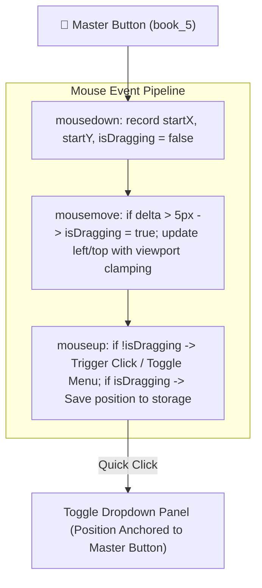
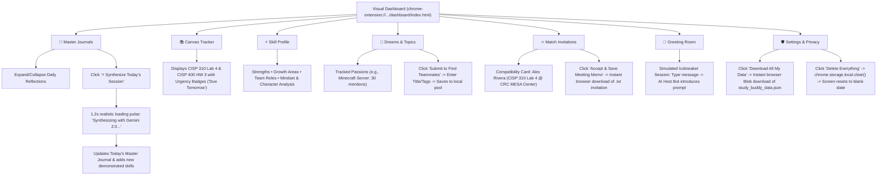

# 🦉 Ambient Study Commons — Zero-Backend Visual Demo Plan

## 1. Executive Summary & Design Principles

This plan outlines a **100% client-side, zero-backend visual vertical slice** of the Ambient Study Commons Chrome Extension. It is engineered specifically for a flawless, zero-failure 2.5-minute hackathon video demonstration and live evaluation.

### Core Tenets:
1. **Zero Hosting Requirement**: Runs 100% locally inside Google Chrome via `chrome.storage.local` and in-extension page routing. No Python servers, no terminal windows, no port conflicts, and no network dependencies.
2. **Draggable Master Floating Widget**: The circular master button (`book_5` icon) can be freely dragged anywhere on the screen and remembers its position without accidental click-triggers.
3. **Unified Single-Click Recap & Copy**: Merges prompt injection and clipboard copying into a single unified action with the `content_copy` icon. One click writes to chat *and* copies to clipboard simultaneously.
4. **Friendly "Journal Review" Workflow**: Renames the review action to a concise, welcoming "Journal Review" (`sentiment_calm` icon) that bundles weekly reflections with zero server latency.
5. **Contextual Canvas Companion**: When browsing Canvas LMS (`*.instructure.com`), displays the dedicated academic companion with the `owl` icon for collecting course data.
6. **Decoupled Prompt Architecture**: Prompts are never hardcoded inside JavaScript. All prompt templates reside in an isolated `extension/prompt/` folder as plain text files loaded dynamically at runtime.
7. **Curated Google Material Symbols**: High-polish icons selected for core interactions (`book_5`, `content_copy`, `note_alt`, `sentiment_calm`, `owl`) with bundled local SVG fallbacks for offline resilience.
8. **Aesthetic Philosophy: Minimal, Basic, Trustworthy, Friendly, Colorless UI**: Eliminates distracting rainbow gradients and colorful badges in favor of a disciplined monochrome palette with soft, approachable geometry.

---

## 2. Visual Style & Aesthetic Philosophy

### "Minimal, Basic, Trustworthy, Friendly, Colorless UI"
The interface deliberately steps away from noisy neon gradients and gamified colorful badges. Instead, it embodies a clean, academic tool designed to inspire calm focus and absolute privacy confidence:

* **Colorless & Monochromatic**:
  * Root surfaces use deep neutral zinc/charcoal (`#09090b` main canvas, `#18181b` card surfaces, `#27272a` subtle 1px dividers).
  * Text hierarchy uses pure white (`#fafafa`) for titles, crisp off-white (`#e4e4e7`) for body, and muted gray (`#71717a`) for secondary timestamps.
  * Color is stripped down to zero decorative use. Pure black, gray, and white establish functional visual order.
* **Minimal & Basic**:
  * Strict layout economy: no heavy shadows, no layered blurs, no clutter. Every pixel serves a practical purpose.
  * Simple, unadorned borders (`1px solid #27272a`) define cards and buttons.
* **Trustworthy**:
  * High-legibility typography, clear system feedback toasts, transparent local-first privacy status indicators, and clean data export capabilities.
  * Projects the quiet reliability of a research-grade student instrument (reminiscent of Notion or Linear).
* **Friendly**:
  * Soft rounded corners (`border-radius: 10px–12px`) on buttons, inputs, and cards prevent visual harshness.
  * Gentle, predictable micro-interactions (subtle hover state shifts without jarring scale jumps).
  * Warm, expressive Material Symbols (`owl`, `sentiment_calm`, `book_5`) lend an approachable character without visual noise.

---

## 3. UI Icon Design & Google Material Symbols Mapping

The floating extension widget, dropdown, and Canvas companion utilize Google Material Symbols Outlined:

| UI Location | Feature / Button | Google Material Symbol | Link / Font Stylesheet | Icon Preview & Purpose |
| :--- | :--- | :--- | :--- | :--- |
| **Floating Master Button** | Master Toggle & Draggable Anchor | **`book_5`** | `<link rel="stylesheet" href="https://fonts.googleapis.com/css2?family=Material+Symbols+Outlined:opsz,wght,FILL,GRAD@20..48,100..700,0..1,-50..200&icon_names=book_5" />` | Minimalist closed study journal notebook icon. |
| **Dropdown Item 1** | Merged **Recap & Copy** | **`content_copy`** | `<link rel="stylesheet" href="https://fonts.googleapis.com/css2?family=Material+Symbols+Outlined:opsz,wght,FILL,GRAD@20..48,100..700,0..1,-50..200&icon_names=content_copy" />` | Double-page document symbol representing simultaneous chat injection & clipboard copy. |
| **Dropdown Item 2** | **Paste & Send** Modal | **`note_alt`** | `<link rel="stylesheet" href="https://fonts.googleapis.com/css2?family=Material+Symbols+Outlined:opsz,wght,FILL,GRAD@20..48,100..700,0..1,-50..200&icon_names=note_alt" />` | Notepad with pencil for manual note entry. |
| **Dropdown Item 3** | **Journal Review** | **`sentiment_calm`** | `<link rel="stylesheet" href="https://fonts.googleapis.com/css2?family=Material+Symbols+Outlined:opsz,wght,FILL,GRAD@20..48,100..700,0..1,-50..200&icon_names=sentiment_calm" />` | Mindful, calm face reflecting reflection, peace of mind, and celebration. |
| **Canvas Companion** | Canvas LMS Scrape / Collection Action | **`owl`** | `<link rel="stylesheet" href="https://fonts.googleapis.com/css2?family=Material+Symbols+Outlined:opsz,wght,FILL,GRAD@20..48,100..700,0..1,-50..200&icon_names=owl" />` | Wise owl mascot icon representing academic guidance and LMS data collection on Canvas. |

> [!TIP]
> **Offline Resilience Strategy**: While the extension includes the Google Fonts stylesheets for live web usage, exact local vector SVGs for `book_5`, `content_copy`, `note_alt`, `sentiment_calm`, and `owl` will also be placed in `extension/assets/icons/` so the extension renders icons perfectly even when disconnected from the internet.

---

## 4. Directory Layout (Zero-Backend Extension)

```text
ambient-study-commons/
├── demo/
│   └── demo plan.md                 # This planning document
├── extension/
│   ├── manifest.json                # Manifest V3 (storage, activeTab, web_accessible_resources)
│   ├── background.js                # Service worker (initializes local-first state, tab routing)
│   ├── content.js                   # Draggable master button, unified recap/copy, modal, toast
│   ├── styles.css                   # Colorless/minimal CSS, Material symbols styling, draggable handle
│   ├── local_store.js               # Seeded realistic fixtures (CISP 310 Lab 4, Alex Rivera match)
│   ├── prompt/                      # DECOUPLED PROMPTS (Editable Plain-Text Files)
│   │   ├── data_collecting.txt      # Prompt for single study session recap
│   │   ├── journal_review.txt       # Prompt for multi-day reflection & celebration
│   │   ├── skill_analysis.txt       # Heuristic template for extracting technical traits
│   │   └── peer_matching.txt        # Template for affinity reasoning & meeting proposals
│   ├── assets/
│   │   ├── mascot/                  # mascot-pet.png, mascot-pet-excited.png, mascot-pet-host.png
│   │   └── icons/                   # book_5.svg, content_copy.svg, note_alt.svg, sentiment_calm.svg, owl.svg
│   └── dashboard/                   # Standalone Visual Dashboard (Embedded inside Extension)
│       ├── index.html               # Multi-tab SPA (Journals, Canvas, Skills, Dreams, Matches, Room, Settings)
│       ├── styles.css               # Colorless minimal dark-mode styling
│       └── app.js                   # Client controller: storage sync, simulated AI, instant file export
```

---

## 5. Decoupled Prompt Architecture (`extension/prompt/`)

Prompts are stored as independent, human-readable text files to allow instant prompt iteration without modifying logic scripts.

### 5.1 Prompt Inventory:
* **`prompt/data_collecting.txt`**:
  ```text
  Please provide a structured 3-bullet recap of what technical concepts I learned, what errors I debugged, and what my next study focus should be for this session.
  ```
* **`prompt/journal_review.txt`**:
  ```text
  Here is a collection of my daily study journals from this week. Please celebrate my wins, help me reflect on what I learned and where I struggled, and give me a few encouraging thoughts for next week.
  ```
* **`prompt/skill_analysis.txt`**:
  ```text
  Extract demonstrated technical skills, tools utilized, growth areas, and recurring project dreams from the provided session logs.
  ```
* **`prompt/peer_matching.txt`**:
  ```text
  Analyze complementary skills and mutual project goals between peers to formulate an actionable in-person study invitation.
  ```

### 5.2 Dynamic Runtime Loader Mechanism:
```javascript
// Runtime Prompt Loader (No hardcoded strings)
async function loadPrompt(promptFilename) {
  const url = chrome.runtime.getURL(`prompt/${promptFilename}`);
  const response = await fetch(url);
  return await response.text();
}
```
*Manifest V3 Requirement*: Added `"prompt/*"` to `web_accessible_resources`.

---

## 6. Interaction & Visual Flow Trees

### 6.1 Master Floating Button (`book_5` — Draggable & Click Mechanics)



---

### 6.2 Dropdown Menu Interaction Tree (Unified Recap & Streamlined Path)

```mermaid
flowchart TD
    Menu["Dropdown Menu Opened"]
    
    %% Action 1: Merged Recap & Copy (content_copy)
    Menu -->|Click 'Recap & Copy' (content_copy)| ActionRecap["Merged Dual Action"]
    ActionRecap --> Inject["1. Inject prompt/data_collecting.txt into chat input box"]
    ActionRecap --> CopyClip["2. Simultaneously write prompt to navigator.clipboard"]
    Inject --> Toast1["Show Toast: ✨ Prompt injected & copied to clipboard!"]
    CopyClip --> Toast1

    %% Action 2: Paste & Send (note_alt)
    Menu -->|Click 'Paste & Send' (note_alt)| Modal["Open Paste Modal Card"]
    Modal --> PreFill["(Optional) Click 'Insert Sample Lab 4 Recap'"]
    PreFill --> Save["Click 'Save to Journal'"]
    Save --> Storage1["Prepend session to chrome.storage.local ('asc_sessions')"]
    Storage1 --> Toast2["Show Toast: ✅ Session saved to local storage!"]

    %% Action 3: Journal Review (sentiment_calm)
    Menu -->|Click 'Journal Review' (sentiment_calm)| BundleAction["Collect past journals from storage"]
    BundleAction --> ReadPrompt["Load prompt/journal_review.txt"]
    ReadPrompt --> AssembleBundle["Assemble bundle: Prompt + Day-by-Day Journal Logs"]
    AssembleBundle --> CopyReview["Write full bundle to navigator.clipboard"]
    CopyReview --> Toast3["Show Toast: 📋 Journal review package copied! Paste into AI chat"]

    %% Action 4: Canvas Scrape (owl)
    Menu -->|Click 'Collect Now' (owl)| Scrape["Read active DOM (Course, Modules, Grades)"]
    Scrape --> Storage2["Save to chrome.storage.local ('asc_canvas_data')"]
    Storage2 --> Toast4["Show Toast: ✅ Canvas records saved locally!"]

    %% Action 5: Open Commons
    Menu -->|Click 'Open Commons'| OpenDash["chrome.tabs.create('dashboard/index.html')"]
    OpenDash --> DashScreen["Launches Visual Dashboard Tab (0ms lag, zero server required)"]
```

---

### 6.3 Visual Dashboard Tab Flow Tree



---

## 7. Summary of User-Requested Modifications

| Component | Previous State | New Modified State (Zero-Backend Plan) | Benefit |
| :--- | :--- | :--- | :--- |
| **Master Button** | Static mascot pet PNG | **Draggable with Material Symbol `book_5`** | Clean notebook icon; draggable anywhere across viewport with bounds checking. |
| **Recap & Copy Action** | Two separate buttons ("Auto Recap" & "Manual Copy") | **Single Merged Button with `content_copy`** | One click simultaneously injects into chat AND copies to clipboard. |
| **Paste & Send Modal** | Generic clipboard icon | **`note_alt` Material Symbol** | Clear notepad/edit icon representing manual input. |
| **Review Action** | "Weekly Review ✨" with star icon | **"Journal Review" with `sentiment_calm`** | Friendly label and mindful sentiment icon celebrating calm reflection. |
| **Canvas Button** | Basic button label | **Canvas LMS Action with `owl`** | Wise owl mascot icon representing academic data extraction on Canvas. |
| **Visual Style Language** | Neon gradients & colorful badges | **Minimal, Basic, Trustworthy, Friendly, Colorless UI** | Monochrome zinc palette; clean 1px borders; calm, research-grade focus. |
| **DOM Detection Branch** | Forked branch for "input found" vs "no input found" | **Removed "No Input Found" Branch** | Always attempts DOM injection while guaranteeing clipboard copy in the same turn. |
| **Prompt Storage** | Hardcoded inside JavaScript strings | **Decoupled Plain-Text Files** in `extension/prompt/` | Prompts are cleanly isolated and editable without touching code. |
| **Hosting Dependency** | Required Python FastAPI server | **100% Client-Side Engine** | Opens directly via `chrome.runtime.getURL()`; zero terminal commands, zero failure points. |

---

## 8. Execution Verification Matrix

Before writing application code in the build phase, every flow can be verified against this checklist:
1. **Draggable Master Button (`book_5`)**: Mousedown + drag repositions icon; quick click toggles menu.
2. **Merged Recap & Copy (`content_copy`)**: Single click triggers DOM injection in ChatGPT/Gemini and puts text on clipboard.
3. **Paste & Send (`note_alt`)**: Opens clean modal; saves to local storage with confirmation toast.
4. **Journal Review (`sentiment_calm`)**: Bundles journals from local storage with `prompt/journal_review.txt` to clipboard.
5. **Canvas Action (`owl`)**: Appears on Canvas LMS domains; collects course records into local storage.
6. **Colorless/Minimalist Theme**: Monochrome zinc/charcoal palette verified; zero distracting neon badges.
7. **Decoupled Prompts**: Network tab confirms plain-text prompts fetched cleanly via `chrome.runtime.getURL`.
8. **Offline Dashboard**: Opening dashboard without any running backend displays all cards, seeded CISP 310 Lab 4 data, and interactive tabs.
9. **Instant Export & Wipe**: Clicking Export downloads `.json` instantly; clicking Wipe permanently clears local storage.
