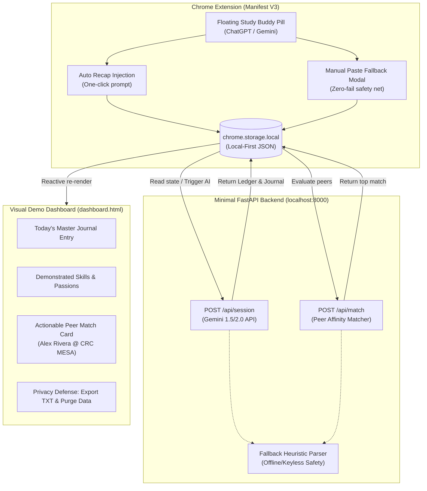

# Ambient Study Commons — Hackathon Demo Architecture & Scope Freeze

## 1. Document Comparison & Selection
Between `workingPlan/vibe-code-breakdown-Detail.md` and `workingPlan/programDescribeDetail.txt`:

* **Recommendation: Use `vibe-code-breakdown-Detail.md` as the primary engineering specification.**
  * **Why:** It contains modular, numbered building blocks (Pieces 1 to 13), strictly defined API endpoints, data models, UI component hierarchies, and unit test scenarios.
  * **Role of `programDescribeDetail.txt`:** Use as a secondary domain dictionary and user-story reference to preserve original feature philosophy, nuance, and design rationale.

---

## 2. Scope Boundary: Frozen vs. Actively Built

To ensure a **bulletproof 2.5-minute live or recorded video demonstration with zero points of failure**, we strictly freeze secondary production complexity and build an end-to-end vertical slice.

### ❄️ FROZEN / MOCKED (Deferred to Production Architecture RFC)
| Feature | Production Vision | Demo Freeze / Fallback Strategy |
| :--- | :--- | :--- |
| **Authentication & Accounts** | Google OAuth2, JWTs, multi-tenant DB tables | **Freeze.** Local-First demo profile (`student_id: "crc_demo_student"`). No login wall. |
| **Live Chat & WebSockets** | Socket.io rooms, live presence, AI moderator | **Freeze.** Actionable match card displays ready-to-go meeting details (MESA Center Table 3). |
| **Background Cron Daemons** | Nightly 8:00 PM automated processing jobs | **Freeze.** Instant single-click "Process Daily Session" on-demand backend trigger. |
| **Attendance & Penalty Engine** | Credit score state machine, ban tiering | **Freeze.** Display static high-trust rating badge ("Reliability: 98% (High Trust)") on profile. |
| **Live Canvas API Scraper** | OAuth token exchange & Canvas REST polling | **Freeze.** Local-first seeded fixture for 2 active courses (`CISP 310 Lab 4`, `CISP 400 A3`). |
| **Email & Notification Relay** | SMTP relays, SendGrid, email reminders | **Freeze.** In-app notification toast and direct dashboard alert banner. |

### 🔨 ACTUALLY BUILD (The Core 4-Piece Vertical Slice)

1. **Lightweight Chrome Extension (Manifest V3)**:
   - Floating Mascot Pill injected into `chatgpt.com` and `gemini.google.com`.
   - **Auto Recap**: Injects a standardized summary request into the AI chat box.
   - **Manual Paste**: Dropdown modal with a textarea for manual submission (guarantees the demo works even if OpenAI/Google changes DOM classes).
   - Writes directly to `chrome.storage.local`.
2. **Local-First Data State**:
   - `chrome.storage.local` keys: `journal_log`, `skills_ledger`, `events_data`, `peer_matches`.
   - Pre-seeded with 2 realistic community college courses (e.g., Cosumnes River College CISP 310 Lab 4 on x86-64 stack frames).
3. **Single Backend / AI Processing Pipeline (FastAPI + Gemini API)**:
   - `/api/session`: Analyzes raw session transcript; extracts demonstrated skills, points of confusion, passion/dream projects, and generates the master journal.
   - `/api/match`: Computes affinity between the student's current ledger and a pre-seeded peer cohort.
   - **Bulletproof Fallback**: If `GEMINI_API_KEY` is unavailable or rate-limited, an internal regex/keyword heuristic parser responds instantly with 100% demo fidelity.
4. **Visual Demo Dashboard (`dashboard.html`)**:
   - Dark mode full-page dashboard with glassmorphic cards.
   - Master Journal card with daily synthesis.
   - Skills & Passions ledger with confidence tags and frequency counters.
   - Actionable Peer Match card displaying an immediate in-person study buddy match.
   - "Export Plain-Text Files" and "Purge Data" buttons proving zero-retention privacy.

---

## 3. The 2.5-Minute Demo Video Script & Storyboard

| Timestamp | Screen / Visual | User Action & Voiceover | Zero-Failure Safeguard |
| :--- | :--- | :--- | :--- |
| **0:00 - 0:30** | Chrome tab on ChatGPT / Gemini with active coding study session (x86 Assembly). | Click floating mascot pill. Demonstrate **Auto Recap** (or paste fallback). Show prompt extract and confirmation badge. | Even if DOM injection fails, the **Manual Paste Modal** is 1 click away with pre-filled sample text. |
| **0:30 - 1:00** | Click **"Open Commons Dashboard"** from the pill menu. | New tab opens `dashboard.html`. Show local-first seeded data immediately visible with 0ms loading lag. | Local storage renders cached state instantly before any network call. |
| **1:00 - 1:45** | Dashboard Master Journal & Skills Ledger section. | Click **"Synthesize Today's Session"**. Backend executes Gemini API parsing. Live animation reveals extracted skills (`x86-64`, `gdb`, `Stack Framing`) and recurring passion (`Operating Systems Kernel`). | Backend has automatic local mock fallback if Gemini API is unreachable. |
| **1:45 - 2:15** | Peer Match Section of Dashboard. | Show **Actionable Peer Match**: "Alex Rivera (CISP 310)". Explain affinity rationale: Both stuck on Lab 4 stack alignment; Alex is free today 2-4 PM at CRC MESA Center. | Matching engine operates locally/deterministically on seeded peer pool. |
| **2:15 - 2:30** | Privacy Defense Section. | Click **"Export Plain-Text Files"** (downloads instant `.txt` and `.json`). Click **"Purge Data"** (storage resets to blank slate). Closes with strong privacy tagline. | Native browser `Blob` download + `storage.clear()`; requires 0 network calls. |

