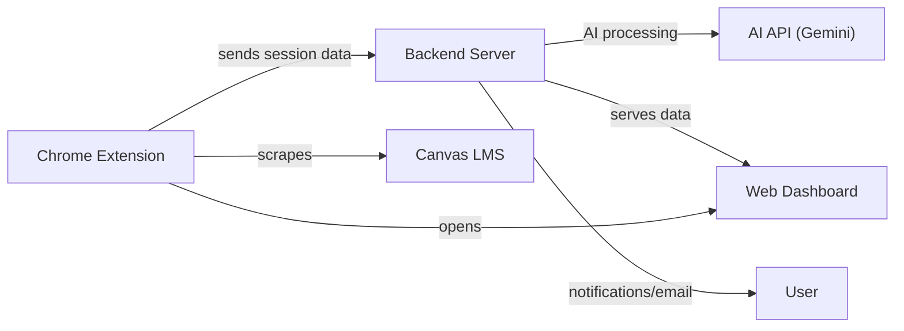
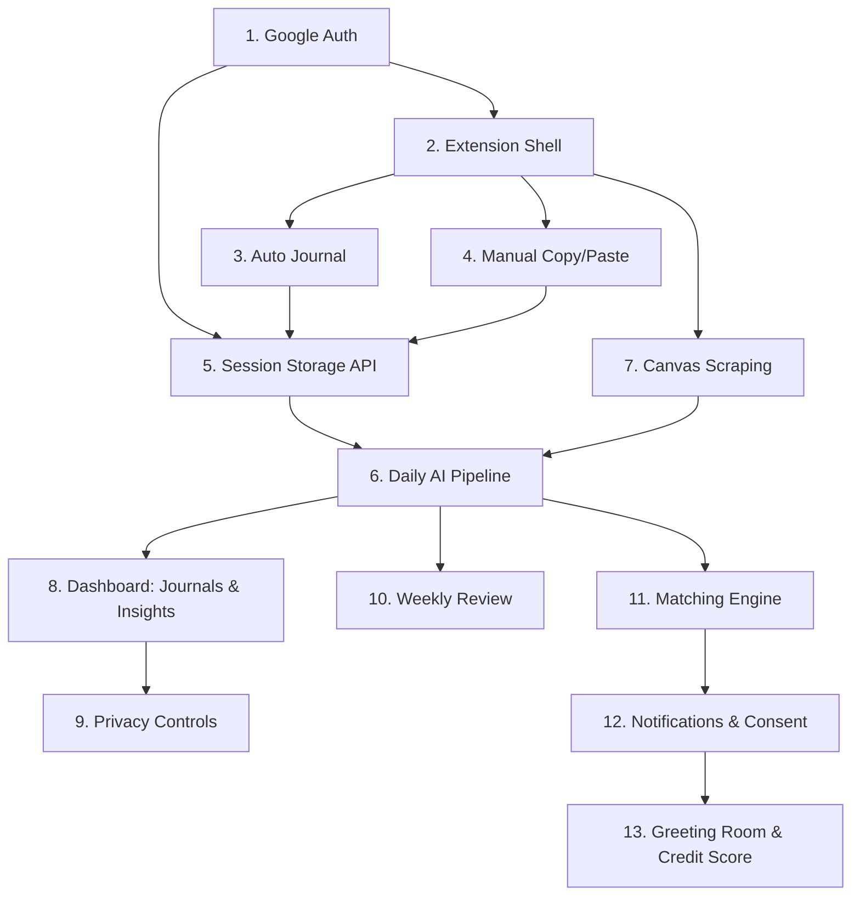

# Ambient Study Commons — Vibe Coding Breakdown (Detailed)

Your app has **3 major systems** (Chrome Extension, Backend Server, Web Dashboard) with **13 independently buildable & testable pieces**. This version includes full UI component specs, data models, API definitions, and asset lists for each piece.

---

## Architecture Overview



---

## Piece 1 — Google Auth & User Accounts
**System:** Backend + Dashboard

**What to build:**
- Google OAuth login flow (1-click sign-in)
- Create user record in database on first login
- Return auth token / session to frontend
- Protected API routes (middleware that checks auth)

**UI components:**
```
loginPage {
  layout: centered card on clean background, max-width 400px

  appLogo { element: mascot-pet.png + app name "Study Buddy" }

  btn_googleSignIn {
    element: "Sign in with Google" button
    icon: google-logo.svg (Google "G" logo)
    style: white button, colored G icon, rounded, shadow on hover
    behavior: click -> Google OAuth popup -> on success, redirect to onboarding or dashboard
  }

  footerText { text: "Your data stays private. We never share it.", muted small text }
}
```

**Data model:**
```
UserAccount {
  id:          string (UUID, primary key)
  email:       string (from Google OAuth, unique)
  displayName: string (from Google profile)
  avatarUrl:   string (Google profile picture URL)
  googleId:    string (unique Google account ID)
  authToken:   string (JWT)
  createdAt:   timestamp
}
```

**API endpoints:**
```
POST /api/auth/google    -> body: { googleIdToken } -> returns: { token, user }
GET  /api/me             -> (requires auth header) -> returns: UserAccount
```

**Resources:** `google-logo.svg`, `mascot-pet.png`

**Test it by:** Clicking "Sign in with Google" → getting a token → calling `/api/me` with that token → seeing your user info.

---

## Piece 2 — Chrome Extension Shell (Floating UI)
**System:** Chrome Extension

**What to build:**
- `manifest.json` (Manifest V3) with permissions for `gemini.google.com`, `chatgpt.com`, `*.instructure.com`
- Content script that detects when user is on Gemini or ChatGPT
- Render the floating mascot widget with button menu

**UI components:**
```
floatingWidget {
  position: fixed, top-right (top: 20px, right: 20px)
  behavior: draggable, stays on top (z-index: 99999)

  mascotButton {
    shape: circular, 48x48px
    icon: mascot-pet.png (cute animal — owl, cat, or capybara)
    style: drop shadow, bounce animation on hover
    cursor: grab (dragging) / pointer (clicking)
    badge: red notification dot when weeklyReview available or match pending
    onClick: toggles dropdownPanel open/close
    tooltip: "Study Buddy" on hover
  }

  dropdownPanel {
    appears: anchored below mascot on click
    size: ~220px wide, auto height
    style: rounded-12px, soft shadow, white or glassmorphism background
    closeButton: "X" in top-right, or click mascot to toggle

    buttonList {
      layout: vertical stack, 8px gap

      btn_autoJournal {
        label: "Auto Journal"
        icon: auto-journal-icon.svg (sparkle/wand)
        style: full-width row (icon left, text right), rounded, hover highlight
        states: idle | loading (spinner) | success (green checkmark, 2s) | error (red X, 2s)
      }
      btn_manualCopy {
        label: "Manual Copy"
        icon: clipboard-copy-icon.svg
        style: same row style
      }
      btn_manualPaste {
        label: "Paste & Send"
        icon: clipboard-paste-icon.svg
        style: same row style
        onClick: opens pasteModal
      }
      btn_viewDashboard {
        label: "Dashboard"
        icon: dashboard-icon.svg (grid/chart)
        style: same row style
        onClick: chrome.tabs.create({ url: dashboardUrl })
      }
      btn_weeklyReview {
        label: "Weekly Review ✨"
        icon: weekly-review-icon.svg (star/calendar)
        style: same row style
        visibility: HIDDEN until backend sets weeklyReviewAvailable = true
        highlight: pulse/glow animation when visible
      }
    }
  }

  pasteModal {
    trigger: btn_manualPaste click
    overlay: semi-transparent dark backdrop
    panel: centered card, max-width 400px, rounded, white, shadow

    heading { text: "Paste your AI's response" }
    textArea {
      placeholder: "Paste the journal summary from your AI here..."
      size: full-width, min-height 150px, resizable vertically
    }
    buttonRow {
      btn_send { label: "Send", icon: send-icon.svg, style: primary }
      btn_cancel { label: "Cancel", style: ghost/outline }
    }
  }

  toastNotification {
    position: bottom-right corner (or near mascot)
    style: rounded pill, slides in from right, auto-dismiss 3 seconds
    variants: success (green) | error (red) | info (blue)
  }
}
```

**Canvas variant** (on `*.instructure.com`):
```
canvasWidget {
  replaces: normal dropdown when on Canvas
  mascotButton: same icon + small "Canvas" badge overlay

  dropdownPanel {
    heading: "Canvas Data Collection"
    description: "Select what to collect:"

    checkboxList {
      chk_modules   { label: "Modules",          icon: book-icon.svg     }
      chk_syllabus  { label: "Course Syllabus",   icon: document-icon.svg }
      chk_grades    { label: "Grades",            icon: grade-icon.svg    }
      chk_events    { label: "Calendar Events",   icon: calendar-icon.svg }
      each synced with UserPreferences on backend
    }

    btn_scrapeNow { label: "Collect Now", style: primary full-width }
    btn_viewDashboard { label: "Open Dashboard", style: text link }
  }
}
```

**Extension file structure:**
```
extension/
├── manifest.json         (Manifest V3 config)
├── background.js         (service worker — auth, API calls, state)
├── content.js            (injected into target sites — renders widget)
├── styles.css            (floating widget styles)
├── popup.html            (optional browser action popup)
├── popup.js
└── assets/
    ├── mascot-pet.png
    ├── auto-journal-icon.svg
    ├── clipboard-copy-icon.svg
    ├── clipboard-paste-icon.svg
    ├── dashboard-icon.svg
    ├── weekly-review-icon.svg
    ├── send-icon.svg
    ├── book-icon.svg
    ├── document-icon.svg
    ├── grade-icon.svg
    └── calendar-icon.svg
```

**Test it by:** Loading unpacked extension → visiting `gemini.google.com` → seeing mascot in top-right → clicking it → seeing the button menu → dragging it around.

---

## Piece 3 — Data Collection: Auto Journal
**System:** Chrome Extension

**What to build:**
When user clicks "Auto Journal":
1. Find the AI chat's input field on the page (DOM selector)
2. Paste the data-collecting prompt text into it
3. Programmatically click the send button
4. Wait for the AI response to finish loading
5. Scrape the response text from the DOM
6. Package: `{ rawText, timestamp, source, collectionMethod: "auto" }`
7. POST to `/api/sessions`
8. Show success/error toast

**DOM selectors (will need updating if sites change):**
```
domSelectors {
  gemini {
    inputField:   "div[contenteditable='true']"  (or the active rich text input)
    sendButton:   "button[aria-label='Send message']" (or similar)
    responseArea: ".model-response-text" (or the latest response container)
  }
  chatgpt {
    inputField:   "textarea#prompt-textarea" (or contenteditable div)
    sendButton:   "button[data-testid='send-button']"
    responseArea: ".markdown.prose" (latest assistant message)
  }
  note: these selectors WILL change — store them in a config object for easy updates
}
```

**Request payload:**
```
POST /api/sessions
{
  rawText:          string    (scraped AI response)
  source:           "gemini" | "chatgpt"
  collectionMethod: "auto"
  timestamp:        ISO 8601 string
}
```

**Button states during flow:**
```
btn_autoJournal states:
  idle     -> shows sparkle icon + "Auto Journal"
  loading  -> shows spinner icon + "Collecting..." (disable button)
  success  -> shows green checkmark + "Saved!" (2 seconds, then back to idle)
  error    -> shows red X + "Failed" (2 seconds, then back to idle) + error toast
```

**Test it by:** Clicking Auto Journal on Gemini → prompt appears in chat → AI responds → toast shows "Saved!" → check backend or console log for the data.

---

## Piece 4 — Data Collection: Manual Copy & Paste
**System:** Chrome Extension

**What to build:**

**Manual Copy flow:**
```
btn_manualCopy {
  onClick:
    1. navigator.clipboard.writeText(DATA_COLLECTING_PROMPT)
    2. show toast: "📋 Prompt copied! Paste it into your AI, then copy the response."
}
```

**Manual Paste flow:**
```
btn_manualPaste {
  onClick: opens pasteModal

  pasteModal {
    textArea { user pastes AI response here }
    btn_send {
      onClick:
        1. read textArea.value
        2. validate non-empty
        3. package: { rawText: value, source: detected from current URL, collectionMethod: "manual", timestamp: new Date().toISOString() }
        4. POST /api/sessions
        5. on success: close modal + show success toast
        6. on error: show inline error message in modal
    }
    btn_cancel { onClick: close modal }
  }
}
```

**Test it by:** Click Manual Copy → paste into AI → copy response → click Paste & Send → paste into textarea → click Send → confirm data saved.

---

## Piece 5 — Session Storage API (Backend CRUD)
**System:** Backend

**What to build:**
- Database table + CRUD endpoints
- Pagination (20 items default)

**Data model:**
```
SessionRecord {
  id:               string (UUID, primary key)
  userId:           string (FK -> UserAccount.id, indexed)
  rawText:          string (the AI response text)
  source:           enum ("gemini", "chatgpt")
  collectionMethod: enum ("auto", "manual")
  timestamp:        timestamp (when the session happened)
  createdAt:        timestamp (when saved to DB)
}
```

**API endpoints:**
```
POST /api/sessions
  body: { rawText, source, collectionMethod, timestamp }
  auth: required (JWT in Authorization header)
  returns: { id, message: "Session saved" }

GET /api/sessions?date=YYYY-MM-DD&page=1&limit=20
  auth: required
  returns: { sessions: SessionRecord[], total: int, page: int, hasMore: bool }

GET /api/sessions?week=YYYY-Wnn&page=1&limit=20
  auth: required
  returns: { sessions: SessionRecord[], total: int, page: int, hasMore: bool }
```

**Test it by:** POST a fake session with curl/Postman → GET it back by date → confirm pagination at 20 items.

---

## Piece 6 — Daily AI Processing Pipeline
**System:** Backend (scheduled job)

**What to build:**
- Cron job at 20:00 (8 PM user time) each day
- 3 AI API calls per user per day

**Pipeline steps:**
```
dailyPipeline {
  trigger: cron "0 20 * * *" (per user timezone)

  for each active user:
    1. sessions = fetch SessionRecord WHERE userId AND date = today
    2. canvasData = fetch CanvasData WHERE userId (if available)
    3. journalResult   = callAI(journalPrompt, sessions, canvasData)
       -> save MasterJournal { date, content, highlights, improvements, sessionCount }
    4. skillResult      = callAI(skillCheckPrompt, sessions)
       -> upsert UserSkill { strengths, weaknesses, teamRoles, experience, mindset, characterAnalysis }
    5. dreamResult      = callAI(dreamCheckPrompt, sessions, existing UserDream list)
       -> for each topic found:
            if similar existing UserDream: mentionCount += 1, append timestamp (keep last 20)
            if new topic: create UserDream { topic, mentionCount: 1, recentTimestamps: [today] }
    6. optionally archive raw SessionRecords for that day
}
```

**Data models:**
```
MasterJournal {
  id:            string (UUID)
  userId:        string (FK)
  date:          date (YYYY-MM-DD, unique per user per day)
  content:       string (AI-generated master journal)
  highlights:    string (notable moments)
  improvements:  string (areas to improve)
  sessionCount:  integer (how many raw sessions merged)
  createdAt:     timestamp
  updatedAt:     timestamp
}

UserSkill {
  userId:            string (FK, primary key or 1:1 with user)
  strengths:         string[] (e.g., ["Problem Solving", "Python", "Leadership"])
  weaknesses:        string[] (e.g., ["Time Management", "Public Speaking"])
  teamRoles:         string[] (e.g., ["Debugger", "Idea Generator", "Researcher"])
  experience:        string[] (e.g., ["Python", "web scraping", "game dev"])
  mindset:           string (AI summary paragraph)
  characterAnalysis: string (AI personality/work-style summary)
  updatedAt:         timestamp
}

UserDream {
  id:               string (UUID)
  userId:           string (FK)
  topic:            string (e.g., "Setup Minecraft server")
  mentionCount:     integer (incremented each time AI finds this topic again)
  recentTimestamps: timestamp[] (last 20 dates mentioned, ordered newest first)
  firstMentioned:   timestamp
  lastMentioned:    timestamp
  status:           enum ("tracking", "submitted_to_pool", "matched")
}
```

**API endpoints:**
```
GET  /api/journals?page=1&limit=20       -> paginated MasterJournal list
GET  /api/journals/:date                 -> single day journal
GET  /api/skills                         -> current user's UserSkill
GET  /api/dreams?page=1&limit=20         -> paginated UserDream list
POST /api/pipeline/trigger               -> (admin/debug) manually trigger pipeline for a user
```

**Test it by:** Seed 2-3 fake sessions → manually trigger pipeline → check DB for new MasterJournal + UserSkill + UserDream entries.

---

## Piece 7 — Canvas Data Scraping
**System:** Chrome Extension + Backend

**What to build:**
- Extension detects Canvas, shows checkboxes, scrapes checked categories
- Backend stores per-user, per-type, and generates reminders

**Data models:**
```
CanvasData {
  id:        string (UUID)
  userId:    string (FK)
  dataType:  enum ("modules", "grades", "syllabi", "events")
  content:   JSON (structured scraped data, shape varies by type)
  scrapedAt: timestamp
}

CanvasReminder {
  id:         string (UUID)
  userId:     string (FK)
  title:      string (e.g., "CS101 Midterm Exam")
  type:       enum ("assignment", "exam", "event")
  dueDate:    timestamp
  courseName: string
  isNotified: boolean (default false)
  createdAt:  timestamp
}
```

**API endpoints:**
```
POST /api/canvas/:type       -> body: { content (JSON) } -> saves CanvasData
GET  /api/canvas/reminders   -> returns upcoming CanvasReminder[]
```

**Scheduled job:**
```
canvasReminderCheck {
  trigger: cron "0 8 * * *" (daily at 8 AM)
  for each user: find CanvasReminder WHERE dueDate within 48 hours AND isNotified = false
  -> send notification (email / extension badge / dashboard alert)
  -> set isNotified = true
}
```

**Resources:** `book-icon.svg`, `document-icon.svg`, `grade-icon.svg`, `calendar-icon.svg`, `assignment-icon.svg`, `exam-icon.svg`, `event-icon.svg`

**Test it by:** Open Canvas → check "Modules" → click Collect Now → confirm data in backend → trigger reminder check → see alert.

---

## Piece 8 — Web Dashboard: Journal & Insights Viewer
**System:** Web Dashboard (frontend)

**What to build:**

**Dashboard shell (shared across all pages):**
```
dashboardApp {
  layout: sidebar (left, 240px, collapsible to 60px) + main content (right)
  style: clean, modern, rounded cards, soft colors

  sidebar {
    userBadge { avatar (circular, from Google) + displayName, top of sidebar }

    navLinks (vertical list, icon + label each):
      nav_journals    { label: "Journals",          icon: journal-nav-icon.svg,    route: /dashboard/journals    }
      nav_canvas      { label: "Canvas Tracker",    icon: canvas-nav-icon.svg,     route: /dashboard/canvas      }
      nav_skills      { label: "Skill Profile",     icon: skills-nav-icon.svg,     route: /dashboard/skills      }
      nav_dreams      { label: "Dreams & Topics",   icon: dreams-nav-icon.svg,     route: /dashboard/dreams      }
      nav_invitations { label: "Invitations",       icon: invitation-nav-icon.svg, route: /dashboard/invitations, badge: pending count }
      nav_greetingRoom{ label: "Greeting Room",     icon: greeting-nav-icon.svg,   route: /dashboard/greeting/:id, visible only if active meeting }
      nav_settings    { label: "Settings",          icon: settings-nav-icon.svg,   route: /dashboard/settings    }
  }
}
```

**Journals page:**
```
journalsPage {
  route: /dashboard/journals

  header { heading: "Your Journals", datePicker: date range/calendar filter }

  journalList {
    layout: vertical card list, 20 items default, "Load More" button at bottom

    journalCard {
      date         { bold date label, e.g., "Monday, Nov 10, 2026" }
      content      { first 3-4 lines truncated + "Read more..." to expand }
      highlights   { small colored tag chips for notable moments }
      improvements { muted text section }
      sessionCount { small badge, e.g., "from 3 sessions" }
      expandable: click to show full journal text
    }
  }
}
```

**Canvas Tracker page:**
```
canvasPage {
  route: /dashboard/canvas

  reminderList {
    layout: vertical cards sorted by dueDate ascending, 20 default

    reminderCard {
      icon: assignment-icon.svg | exam-icon.svg | event-icon.svg (based on type)
      title      { text: "CS101 Midterm Exam" }
      courseName { muted text: "CS101 - Intro to Computer Science" }
      dueDate    { text: "Nov 15, 2026 at 2:00 PM" }
      urgencyBadge { "Due Today" (red) | "Tomorrow" (orange) | "This Week" (yellow) | "Upcoming" (gray) }
    }
  }
}
```

**Skills page:**
```
skillsPage {
  route: /dashboard/skills

  header { heading: "Skill & Growth Profile" }
  lastUpdated { muted: "Last updated: Nov 10, 2026" }

  strengthsCard  { heading: "Strengths 💪",         color: green-tint,  content: tag chips list }
  weaknessesCard { heading: "Growth Areas 🌱",      color: amber-tint,  content: tag chips list }
  teamRolesCard  { heading: "Team Roles 🧩",        color: blue-tint,   content: tag chips list }
  mindsetCard    { heading: "Mindset & Character 🧠", color: purple-tint, content: AI paragraph }
}
```

**Resources:** All nav icons listed above + assignment/exam/event icons

**Test it by:** Seed DB with fake journals, skills, dreams → load dashboard → confirm all pages render → test pagination with 25+ items.

---

## Piece 9 — Dashboard: Data & Privacy Controls
**System:** Web Dashboard + Backend

**What to build:**
```
settingsPage {
  route: /dashboard/settings

  section_permissions {
    heading: "Data Collection Permissions"
    toggles: toggle_aiChats, toggle_canvasModules, toggle_canvasGrades, toggle_canvasSyllabi, toggle_canvasEvents
    each toggle: ON/OFF switch, on change -> PUT /api/me/preferences
  }

  section_reviewCycle {
    heading: "Review Schedule"
    input_days { type: dropdown (3, 5, 7, 14 days), default 7 }
    on change -> PUT /api/me/preferences { reviewCycleDays }
  }

  section_freeTime {
    heading: "Your Free Time"
    weekGrid { 7 columns (Mon-Sun) x 3 rows (Morning/Afternoon/Evening), click to toggle }
    saveButton -> PUT /api/me/freetime
  }

  section_dataExport {
    heading: "Export Your Data"
    btn_export { label: "Download All My Data", icon: download-icon.svg }
    behavior: POST /api/data/export -> browser downloads .zip
  }

  section_dataDeletion {
    style: soft red/orange border warning section

    btn_partialDelete { label: "Select & Delete Specific Data" }
    -> opens partialDeleteModal {
      tabs: Journals | Dreams | Canvas
      each tab: item list with checkboxes
      btn_deleteSelected -> DELETE /api/data/partial { type, ids[] }
    }

    btn_wipeEverything { label: "Delete Everything", icon: trash-icon.svg, style: solid red }
    -> opens confirmWipeModal {
      warningText: "This will permanently erase ALL your data."
      confirmInput { placeholder: "Type DELETE to confirm" }
      btn_confirm { disabled until input = "DELETE" } -> DELETE /api/data/wipe
    }
  }

  section_creditScore {
    heading: "Your Reliability Score"
    scoreDisplay { large number + color gauge (green/yellow/red), icon: shield-icon.svg }
    description: "Private to you only. Affects matching priority."
  }
}
```

**Data model:**
```
UserPreferences {
  userId:              string (FK, 1:1 with user)
  collectAiChats:      boolean (default false)
  collectCanvasModules: boolean (default false)
  collectCanvasGrades: boolean (default false)
  collectCanvasSyllabi: boolean (default false)
  collectCanvasEvents: boolean (default false)
  reviewCycleDays:     integer (default 7)
  updatedAt:           timestamp
}

FreeTimeSlot {
  userId:     string (FK)
  dayOfWeek:  enum (MON..SUN)
  timeBlock:  enum (MORNING, AFTERNOON, EVENING)
  isAvailable: boolean
}
```

**API endpoints:**
```
PUT    /api/me/preferences     -> update toggles and review cycle
PUT    /api/me/freetime        -> update free time grid
POST   /api/data/export        -> returns download URL for .zip
DELETE /api/data/partial       -> body: { type, ids[] }
DELETE /api/data/wipe          -> body: { confirmToken: "DELETE" }
GET    /api/credit-score       -> returns { score, totalMeetings, totalAttended, totalNoShows }
```

**Resources:** `download-icon.svg`, `trash-icon.svg`, `shield-icon.svg`

**Test it by:** Toggle permissions → confirm extension respects them. Export → open zip. Delete a journal → confirm gone. Wipe → confirm empty.

---

## Piece 10 — Weekly Review Flow
**System:** Chrome Extension + Backend

**What to build:**

**Backend flag:**
```
weeklyReviewTrigger {
  trigger: cron based on UserPreferences.reviewCycleDays (default 7)
  action: sets weeklyReviewAvailable = true for that user
  endpoint: GET /api/weekly-review/status -> { available: bool, weekStart, weekEnd }
}
```

**Extension behavior:**
```
btn_weeklyReview {
  visibility check: polls GET /api/weekly-review/status periodically (or via push)
  when available = true: show button with pulse/glow animation + "New!" badge

  onClick:
    1. GET /api/weekly-review/bundle -> returns { journals[], reviewPrompt }
    2. assemble clipboard text:
       "[reviewPrompt]\n\n--- Monday ---\n[journal]...\n--- Tuesday ---\n[journal]..."
    3. navigator.clipboard.writeText(bundleText)
    4. show toast: "📋 Your weekly review is copied! Open your favorite AI and paste it."
    5. button changes to "Copied! ✓" for 3 seconds
}
```

**API endpoint:**
```
GET /api/weekly-review/status  -> { available: bool, weekStart: date, weekEnd: date }
GET /api/weekly-review/bundle  -> { journals: MasterJournal[], reviewPrompt: string }
```

**Resources:** `weekly-review-icon.svg`, `clipboard-check-icon.svg`

**Test it by:** Set review available flag → button appears with glow → click → paste into any AI → confirm it has your journals + prompt.

---

## Piece 11 — Matching Engine & Dream Pool
**System:** Backend

**What to build:**

**Data models:**
```
DreamPoolEntry {
  id:              string (UUID)
  submittedByUserId: string (FK)
  title:           string (e.g., "Build a Minecraft Server")
  description:     string (user-written description)
  tags:            string[] (e.g., ["gaming", "servers", "Java"])
  sourceType:      enum ("user_dream", "hackathon", "campus_event")
  status:          enum ("active", "matched", "expired", "archived")
  createdAt:       timestamp
  expiresAt:       timestamp (optional)
}

MatchRecord {
  id:                  string (UUID)
  userIdA:             string (FK)
  userIdB:             string (FK)
  dreamPoolEntryId:    string (FK, optional)
  matchedDreamTopics:  string[]
  similarityScore:     float (0.0 - 1.0)
  skillComplementNotes: string (AI summary)
  respondedA:          enum ("pending", "accepted", "declined")
  respondedB:          enum ("pending", "accepted", "declined")
  status:              enum ("pending_a", "pending_b", "pending_both", "accepted", "declined", "scheduled", "completed", "no_show")
  createdAt:           timestamp
}
```

**Dream submission UI (on dashboard dreamsPage):**
```
dreamsPage {
  route: /dashboard/dreams

  dreamList {
    layout: vertical cards, 20 default, Load More

    dreamCard {
      topic        { bold text, e.g., "Setup Minecraft Server" }
      mentionCount { badge: "Mentioned 30 times" }
      recentDates  { small text: "Last: Nov 10, Nov 8, Nov 5..." }
      statusBadge  { "Tracking" (gray) | "Submitted" (blue) | "Matched!" (green) }
      btn_submitToPool {
        label: "Submit to Find Teammates"
        icon: rocket-icon.svg
        visibility: shown when status = "tracking" AND mentionCount >= threshold (e.g., 5)
        onClick: opens dreamSubmitModal
      }
    }
  }

  dreamSubmitModal {
    heading: "Submit Your Dream to the Matching Pool"
    input_title       { label: "Project Title", pre-filled with dream topic }
    input_description { label: "Describe your idea", textarea }
    input_tags        { label: "Tags", tag input (comma separated) }
    btn_submit -> POST /api/dreams/:id/submit
    btn_cancel
  }
}
```

**Matching algorithm (scheduled):**
```
matchingEngine {
  trigger: cron "0 */6 * * *" (every 6 hours, configurable)

  for each DreamPoolEntry with status = "active":
    for each other user (not the submitter):
      1. dreamSimilarity = compareTags(entry.tags, otherUser.UserDream[].topics)
         threshold: >= 0.80 (80% similarity)
      2. skillComplement = checkSkills(submitter.UserSkill, otherUser.UserSkill)
         looking for: complementary roles (not identical)
      3. timeOverlap = compareFreeTime(submitter.FreeTimeSlot[], otherUser.FreeTimeSlot[])
         requirement: at least 1 overlapping slot
      4. creditCheck = otherUser.CreditScore.score >= minimumThreshold
      5. if all pass: create MatchRecord, save to both users' pending invitations
}
```

**API endpoints:**
```
POST /api/dreams/:id/submit    -> body: { title, description, tags } -> creates DreamPoolEntry
GET  /api/invitations?page=    -> paginated pending MatchRecord list for current user
```

**Resources:** `rocket-icon.svg`, `hourglass-icon.svg` (empty state)

**Test it by:** Create 2 test users with similar dream tags + complementary skills + overlapping free time → run matcher → both get pending invitations.

---

## Piece 12 — Notification System & Match Consent Flow
**System:** Chrome Extension + Backend + Dashboard

**What to build:**

**Active detection (extension):**
```
activeDetection {
  method: background.js checks if any supported tab is focused + user interacted in last 5 min
  active: supported tab focused + recent interaction
  inactive: no supported tab or idle > 5 minutes
}
```

**Match popup (extension, when active):**
```
extensionMatchPopup {
  trigger: backend pushes notification + user is active
  position: top-right, slides down (or near mascot)
  size: ~320px wide, auto height
  style: rounded card, shadow, white

  mascotIcon { mascot-pet-excited.png (excited variant), left side }
  messageText { "I found someone who shares your dream on [Topic]! Want me to arrange a greeting?" }
  btn_yes   { label: "Yes, let's meet!", style: primary }
  btn_later { label: "Maybe later", style: ghost, saves to dashboard inbox }
  autoDismiss: 30 seconds -> saves to dashboard inbox
}
```

**Dashboard invitations (when inactive or for review):**
```
invitationsPage {
  route: /dashboard/invitations

  emptyState { text: "No pending invitations.", icon: hourglass-icon.svg }

  invitationList {
    layout: vertical cards, 20 default

    invitationCard {
      topic         { bold: "Building a Minecraft Server" }
      matchSummary  { "We found someone with complementary skills!" }
      sharedSkills  { tag chips of overlapping skills }
      suggestedTime { "Suggested greeting: Sat Nov 15, 3:00 PM" }
      btn_accept  { label: "Yes, arrange a greeting!", icon: checkmark-icon.svg, style: green primary }
      btn_decline { label: "Not now", style: ghost }
      btn_accept  -> POST /api/invitations/:id/respond { action: "accept" }
      btn_decline -> POST /api/invitations/:id/respond { action: "decline" }
    }
  }
}
```

**Consent + scheduling:**
```
consentFlow {
  1. UserA accepts -> respondedA = "accepted", check respondedB
  2. UserB accepts -> respondedB = "accepted"
  3. BOTH accepted -> backend finds mutual FreeTimeSlot -> creates Meeting { scheduledAt }
  4. status = "scheduled"
  5. send confirmationEmail to both users
  6. 5 hours before meeting: send reminderEmail to both
}
```

**Data model:**
```
Meeting {
  id:          string (UUID)
  matchId:     string (FK -> MatchRecord.id)
  scheduledAt: timestamp
  userIdA:     string
  userIdB:     string
  confirmedA:  boolean (responded to 5-hour reminder)
  confirmedB:  boolean
  roomStatus:  enum ("waiting", "active", "completed", "cancelled")
  createdAt:   timestamp
}
```

**API endpoints:**
```
POST /api/invitations/:id/respond  -> body: { action: "accept"|"decline" }
```

**Email templates:**
```
confirmationEmail {
  subject: "Reminder: Your greeting is in 5 hours!"
  body: greeting + meeting details + "Open Dashboard" CTA button
  resource: email-template-confirmation.html
}
matchNotificationEmail {
  subject: "We found a match for your dream: [topic]!"
  body: match summary + dashboard link
  resource: email-template-match.html
}
```

**Resources:** `mascot-pet-excited.png`, `checkmark-icon.svg`, `hourglass-icon.svg`, email templates

**Test it by:** Trigger match → active user sees popup → inactive user sees dashboard notification → both accept → meeting scheduled → confirmation email sent 5h before.

---

## Piece 13 — Greeting Room & Credit Score
**System:** Web Dashboard + Backend

**What to build:**

**Greeting Room UI:**
```
greetingRoomPage {
  route: /dashboard/greeting/:meetingId

  header {
    heading: "Greeting Room"
    topicBadge { highlighted chip: "Topic: [Dream Topic]" }
    status     { "Waiting for participant..." | "Meeting started at 3:00 PM" }
  }

  chatArea {
    layout: vertical scroll, messages top to bottom, chat bubble style

    messageBubble {
      ai_host:    left-aligned, purple/blue, mascot-pet-host.png avatar
      self:       right-aligned, primary color
      other_user: left-aligned, neutral color, their Google avatar
      content: text message
      timestamp: small muted time below
    }

    aiHostScript (AI moderator scripted sequence):
      1. "Welcome! I'm excited to introduce you both. 🎉"
      2. "You both share an interest in [Topic]. [UserA], would you like to start?"
      3. (after exchange) "It sounds like you both have great ideas! How would you approach [Topic] together?"
      4. (after warm-up) "This has been wonderful! Feel free to exchange contact info — Discord, email, or GitHub."
      5. "I'll step away now. Good luck with [Topic]! 🚀"
  }

  inputArea {
    layout: bottom fixed bar
    textInput { placeholder: "Type a message...", full width }
    btn_send  { icon: send-icon.svg, circular primary button }
    connection: WebSocket (real-time)
  }
}
```

**Credit Score system:**
```
CreditScore {
  userId:                 string (FK, 1:1)
  score:                  integer (default 50)
  totalMeetingsScheduled: integer
  totalMeetingsAttended:  integer
  totalNoShows:           integer
  history:                CreditEvent[]
}

CreditEvent {
  id:          string (UUID)
  userId:      string
  meetingId:   string (FK)
  eventType:   enum ("attended", "no_show")
  pointChange: integer (-1 for no_show)
  newScore:    integer (score after this event)
  createdAt:   timestamp
}

noShowDetection {
  trigger: 15 minutes after Meeting.scheduledAt
  if user did not join greeting room:
    CreditScore.score -= 1
    CreditScore.totalNoShows += 1
    create CreditEvent { eventType: "no_show", pointChange: -1 }
    MatchRecord.status = "no_show"
}
```

**API endpoints:**
```
GET  /api/greeting-room/:meetingId       -> { meetingInfo, topic, participants, wsUrl }
POST /api/greeting-room/:meetingId/join  -> joins room, triggers WebSocket connection
GET  /api/credit-score                   -> { score, totalMeetings, totalAttended, totalNoShows }
```

**Resources:** `mascot-pet-host.png`, `send-icon.svg`, `shield-icon.svg`

**Test it by:** Two test users join room → AI greets → conversation → AI suggests contact exchange → session ends. Simulate no-show → credit score drops by 1.

---

## Suggested Build Order



> [!TIP]
> **Start with Pieces 1 → 2 → 5 → 3/4.** This gives you auth, the extension UI, and data flowing end-to-end.

> [!IMPORTANT]
> **Pieces 3 & 4** depend on AI site DOM structure. Build selectors in a config object so they're easy to update when sites change.

---

## Complete Asset List

```
mascot/
  mascot-pet.png              — main mascot (floating widget)
  mascot-pet-excited.png      — match popup variant
  mascot-pet-host.png         — greeting room AI host avatar

icons/
  google-logo.svg             — sign-in button
  auto-journal-icon.svg       — sparkle/wand (auto journal)
  clipboard-copy-icon.svg     — manual copy
  clipboard-paste-icon.svg    — manual paste
  clipboard-check-icon.svg    — copied confirmation
  dashboard-icon.svg          — view dashboard
  weekly-review-icon.svg      — weekly review
  send-icon.svg               — send buttons
  download-icon.svg           — data export
  trash-icon.svg              — delete data
  shield-icon.svg             — credit score
  hourglass-icon.svg          — empty invitations
  rocket-icon.svg             — submit dream
  checkmark-icon.svg          — accept invitation
  chat-bubble-icon.svg        — AI chats toggle
  book-icon.svg               — modules
  document-icon.svg           — syllabi
  grade-icon.svg              — grades
  calendar-icon.svg           — events
  journal-nav-icon.svg        — nav: journals
  canvas-nav-icon.svg         — nav: canvas
  skills-nav-icon.svg         — nav: skills
  dreams-nav-icon.svg         — nav: dreams
  invitation-nav-icon.svg     — nav: invitations
  greeting-nav-icon.svg       — nav: greeting room
  settings-nav-icon.svg       — nav: settings
  assignment-icon.svg         — canvas: assignment
  exam-icon.svg               — canvas: exam
  event-icon.svg              — canvas: event

email-templates/
  email-template-confirmation.html
  email-template-match.html
```

---

## Complete Data Model Summary

```
UserAccount          — Google auth user profile
UserPreferences      — data collection toggles + review cycle setting
FreeTimeSlot         — availability grid (day + time block)
SessionRecord        — raw AI session data (before daily processing)
MasterJournal        — AI-generated daily journal (replaces sessions)
UserSkill            — AI-analyzed strengths, weaknesses, roles, mindset
UserDream            — tracked topics with mention counts + timestamps
CanvasData           — scraped Canvas content by type
CanvasReminder       — upcoming assignments/exams with due dates
DreamPoolEntry       — submitted dream projects in the matching pool
MatchRecord          — match between two users with consent tracking
Meeting              — scheduled greeting with room status
CreditScore          — private reliability score per user
CreditEvent          — log of score changes (attended/no-show)
```

---

## Complete API Endpoint Summary

```
AUTH
  POST   /api/auth/google
  GET    /api/me
  PUT    /api/me/preferences
  PUT    /api/me/freetime

SESSIONS
  POST   /api/sessions
  GET    /api/sessions?date=&page=&limit=

JOURNALS & INSIGHTS
  GET    /api/journals?page=&limit=
  GET    /api/journals/:date
  GET    /api/skills
  GET    /api/dreams?page=&limit=

CANVAS
  POST   /api/canvas/:type
  GET    /api/canvas/reminders

WEEKLY REVIEW
  GET    /api/weekly-review/status
  GET    /api/weekly-review/bundle

DREAM POOL & MATCHING
  POST   /api/dreams/:id/submit
  GET    /api/invitations?page=
  POST   /api/invitations/:id/respond

GREETING ROOM
  GET    /api/greeting-room/:meetingId
  POST   /api/greeting-room/:meetingId/join

CREDIT SCORE
  GET    /api/credit-score

DATA MANAGEMENT
  POST   /api/data/export
  DELETE /api/data/partial
  DELETE /api/data/wipe

ADMIN/DEBUG
  POST   /api/pipeline/trigger
```

---

## Tech Stack Suggestion

| Layer | Suggestion | Why |
|-------|-----------|-----|
| Chrome Extension | Manifest V3, vanilla JS or React | Modern extension standard |
| Backend | Node.js + Express (or Python + FastAPI) | Quick to prototype |
| Database | PostgreSQL or Firebase/Firestore | Structured data + easy queries |
| AI API | Gemini API | Already in your ecosystem |
| Real-time Chat | WebSocket (Socket.io) | Greeting room needs real-time |
| Auth | Google OAuth 2.0 | One-click, matches your user base |
| Email | SendGrid or Gmail API | Notifications & confirmations |

