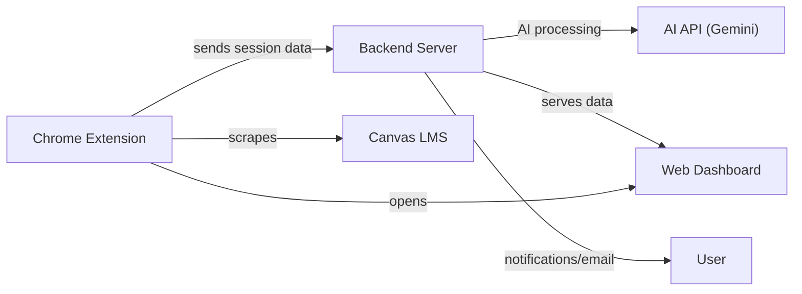
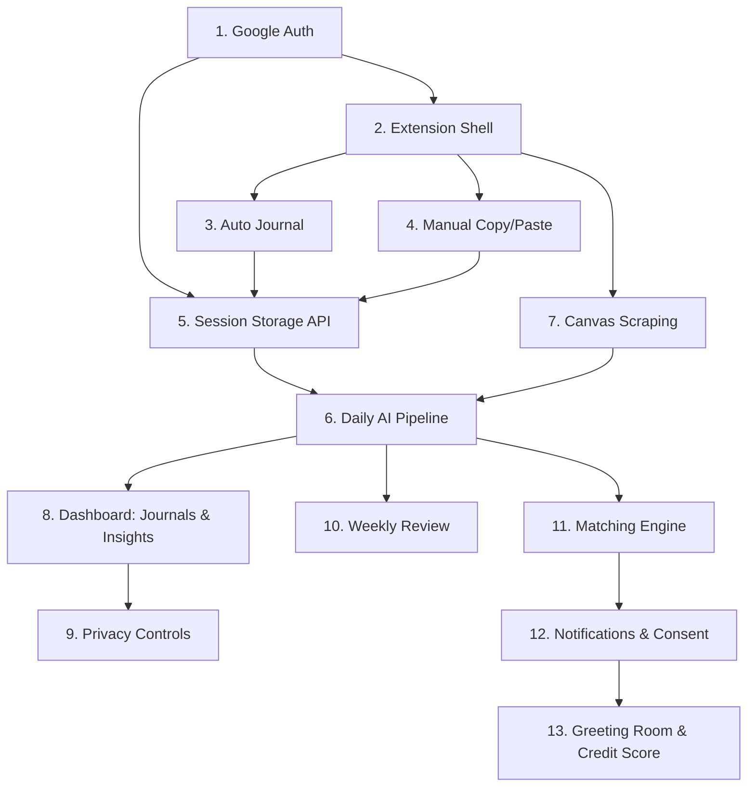

# Ambient Study Commons — Vibe Coding Breakdown

Your app has **3 major systems** (Chrome Extension, Backend Server, Web Dashboard) with **13 independently buildable & testable pieces**. Work through them roughly in this order — each piece stands on its own so you can test it before moving on.

---

## Architecture Overview

---

## Piece 1 — Google Auth & User Accounts
**System:** Backend + Dashboard  
**What to build:**
- Google OAuth login flow (1-click sign-in)
- Create user record in database on first login
- Return auth token / session to frontend
- Protected API routes (middleware that checks auth)

**Test it by:** Clicking "Sign in with Google" → getting a token → calling a protected `/api/me` endpoint and seeing your user info returned.

---

## Piece 2 — Chrome Extension Shell (Floating UI)
**System:** Chrome Extension  
**What to build:**
- `manifest.json` with permissions for `gemini.google.com`, `chatgpt.com`, `*.instructure.com` (Canvas)
- Content script that detects when user is on Gemini or ChatGPT
- Render a small **floating rectangle box** with buttons:
  - 🤖 Auto Journal
  - 📋 Manual Copy
  - 📝 Manual Paste (opens text input)
  - 📊 View Dashboard (opens dashboard tab)
  - 📅 Weekly Review (hidden until activated)
- No backend connection yet — just the UI

**Test it by:** Loading the unpacked extension → visiting `gemini.google.com` → seeing the floating box appear with clickable buttons.

---

## Piece 3 — Data Collection: Auto Journal
**System:** Chrome Extension  
**What to build:**
- When user clicks "Auto Journal":
  1. Paste the data-collecting prompt into the AI chat's input field
  2. Programmatically send it
  3. Wait for & scrape the AI's response text
  4. Package it with a timestamp
  5. POST to backend API: `POST /api/sessions` with `{ text, timestamp, source: "gemini"|"chatgpt" }`
- Show success/failure notification in the floating box

**Test it by:** Clicking "Auto Journal" on Gemini → seeing the prompt appear → AI responds → checking your backend receives the data (or log it to console first).

---

## Piece 4 — Data Collection: Manual Copy & Paste
**System:** Chrome Extension  
**What to build:**
- **Manual Copy button:** Copies the data-collecting prompt to clipboard + shows instruction toast
- **Manual Paste button:** Opens a textarea popup where user pastes AI response → click "Send" → adds timestamp → POST to same `/api/sessions` endpoint
- Success/failure notification

**Test it by:** Clicking Manual Copy → pasting prompt into AI yourself → copying response → clicking Manual Paste → pasting into textarea → clicking Send → confirming data reaches backend.

---

## Piece 5 — Session Storage API (Backend CRUD)
**System:** Backend  
**What to build:**
- Database schema: `sessions` table (id, user_id, text, source, timestamp, created_at)
- `POST /api/sessions` — save a new session
- `GET /api/sessions?date=YYYY-MM-DD` — get sessions for a specific day
- `GET /api/sessions?week=YYYY-Wnn` — get sessions for a week
- Pagination: return 20 items by default, support `?page=` or `?cursor=`

**Test it by:** Using Postman/curl to POST a session, then GET it back. Confirm pagination returns 20 items max.

---

## Piece 6 — Daily AI Processing Pipeline (Master Journal + Skills + Dreams)
**System:** Backend (scheduled job)  
**What to build:**
- **Cron/scheduled job** that fires daily at 20:00 (8 PM user time)
- Collects all sessions for that user+day
- Sends them to AI API with **3 separate prompts**:
  1. **Journal prompt** → generates master daily journal → saves to `journals` table
  2. **skillCheck prompt** → extracts strengths, weaknesses, team roles, mindset → upserts `user_skills` record
  3. **dreamCheck prompt** → extracts dreams/topics → compares with existing `user_dreams` → if similar topic found, increment `mention_count` and append timestamp (keep latest 20 timestamps)
- Replaces individual sessions with the master journal for that day

**Test it by:** Manually triggering the pipeline for a test user with 2-3 fake sessions → checking that a master journal, updated skills, and dream entries are created in the database.

---

## Piece 7 — Canvas Data Scraping
**System:** Chrome Extension + Backend  
**What to build:**
- Extension detects user on Canvas (`*.instructure.com`)
- Shows dropdown with permission checkboxes: Modules, Syllabus, Grades, Calendar Events
- Based on checked permissions, scrape data via Canvas page DOM or Canvas API
- POST to backend: `POST /api/canvas/{type}` (e.g., `/api/canvas/modules`, `/api/canvas/grades`)
- Backend stores per-user, per-type (separate tables or files)
- Backend AI analysis: generate upcoming assignment/exam reminders from canvas data

**Test it by:** Opening Canvas with extension loaded → checking the permission checkboxes → scraping modules → confirming data appears in your backend. Then trigger the AI reminder analysis and check the output.

---

## Piece 8 — Web Dashboard: Journal & Insights Viewer
**System:** Web Dashboard (frontend)  
**What to build:**
- **Daily Journal view:** List of master journal entries, paginated (20 default), with date picker
- **Canvas Tracker:** Upcoming exams/assignments with reminder alerts
- **Skill & Growth Profile:** Display parsed `userSkill` data (strengths, weaknesses, team roles, mindset)
- **Dream Topics:** Show tracked topics with mention counts (e.g., "Minecraft server: mentioned 30 times")
- Load More / infinite scroll for all lists

**Test it by:** Seeding the database with fake journals, skills, and dreams → loading the dashboard → confirming everything renders correctly and pagination works.

---

## Piece 9 — Dashboard: Data & Privacy Controls
**System:** Web Dashboard + Backend  
**What to build:**
- **Permission toggles:** ON/OFF switches for each data category (ChatGPT sessions, Gemini sessions, Canvas modules, grades, syllabi, events) → saved to user preferences in backend
- **Data Export:** "Download All My Data" button → backend zips journals + skills + dreams + canvas data → returns downloadable file
- **Partial Delete:** Select specific journal days, dream tags, or canvas logs to delete
- **Wipe Everything:** Master delete button → confirms → erases all user data from database

**Test it by:** Toggling permissions and confirming the extension respects them. Exporting data and opening the file. Deleting a specific journal and confirming it's gone. Wiping everything and confirming empty state.

---

## Piece 10 — Weekly Review Flow
**System:** Chrome Extension + Backend  
**What to build:**
- Backend triggers "weekly review available" signal at end of week (or user-configured review cycle)
- Extension shows the **Weekly Review button** (was hidden until now)
- Clicking it:
  1. Fetches all daily journals for the past week from backend
  2. Bundles them with the weekly review prompt
  3. Copies the entire package to clipboard
  4. Shows notification: "Your weekly review is copied! Paste it into your favorite AI."
- User pastes into any AI (ChatGPT, Gemini, Claude, etc.) for an interactive reflection session

**Test it by:** Manually setting the "review available" flag → clicking the Weekly Review button → pasting clipboard into an AI and confirming it contains your week's journals + the review prompt.

---

## Piece 11 — Matching Engine & Dream Pool
**System:** Backend  
**What to build:**
- **Dream Pool table:** Stores submitted dream projects (title, description, tags, user_id)
- **AI Publishing Suggestion:** When `mention_count` exceeds threshold → prompt user to submit dream to pool
- **Matching Algorithm:**
  - Compare `userDream` tags across all users: ≥ 80% similarity threshold
  - Check `userSkill` for complementary roles
  - Check free-time schedules for overlapping availability
- **Match Notification:** When match found → save invitation to both users' pending invitations
- Users can NOT browse the pool — they only see matches the AI sends them

**Test it by:** Creating 2 test users with similar dream tags + complementary skills + overlapping free time → running the matcher → confirming both receive a pending invitation.

---

## Piece 12 — Notification System & Match Consent Flow
**System:** Chrome Extension + Backend + Dashboard  
**What to build:**
- **Active user detection:** Extension checks if user is actively browsing
- **If active:** Show match popup in extension: "I found someone who shares your dream on [Topic]. Arrange a greeting?"
- **If inactive:** Save to dashboard pending invitations inbox (no popup spam)
- **Consent flow:** Both users must click "Yes" → backend locks in meeting slot from shared free time
- **Confirmation email:** Send email with meeting details 5 hours before meeting
- **Dashboard invitations panel:** View/accept/decline pending match invitations

**Test it by:** Triggering a match for 2 test users → confirming active user gets popup → inactive user gets dashboard notification → both accept → meeting is scheduled → confirmation email sent.

---

## Piece 13 — Greeting Room & Credit Score
**System:** Web Dashboard + Backend  
**What to build:**
- **Greeting Room:** Lightweight real-time chat room on dashboard (WebSocket or similar)
- **AI Host/Moderator:**
  1. Greets both participants
  2. Introduces the shared dream/project as icebreaker
  3. Facilitates warm-up conversation
  4. Suggests exchanging contact info (Discord, email, GitHub)
  5. Wraps up and steps away
- **Credit Score System:**
  - Each user starts with a default score (visible ONLY to themselves on dashboard)
  - -1 point for no-show or missing a confirmed meeting
  - Lower score = deprioritized in matching algorithm = fewer invitations
- **Free Time / Scheduling Settings:** Dashboard UI for entering available time slots

**Test it by:** Two test users enter the greeting room at scheduled time → AI host introduces them → conversation happens → AI suggests contact exchange → session ends. Then simulate a no-show and confirm credit score drops by 1.

---

## Suggested Build Order

> [!TIP]
> **Start with Pieces 1 → 2 → 5 → 3/4.** This gives you auth, the extension UI, and data flowing end-to-end. You'll have something working and testable within the first few sessions. Everything else builds on top.

> [!IMPORTANT]
> **Pieces 3 & 4** (auto/manual data collection) depend on the AI sites' DOM structure, which can change. Build these with selectors that are easy to update. Consider making the selectors configurable.

---

## Tech Stack Suggestion

| Layer | Suggestion | Why |
|-------|-----------|-----|
| Chrome Extension | Manifest V3, vanilla JS or React | Modern extension standard |
| Backend | Node.js + Express (or Python + FastAPI) | Quick to prototype |
| Database | PostgreSQL or Firebase/Firestore | Structured data + easy queries |
| AI API | Gemini API | Already in your ecosystem |
| Real-time Chat | WebSocket (Socket.io) | Greeting room needs real-time |
| Auth | Google OAuth 2.0 | One-click, matches your user base |
| Email | SendGrid or Gmail API | Notifications & confirmations |

